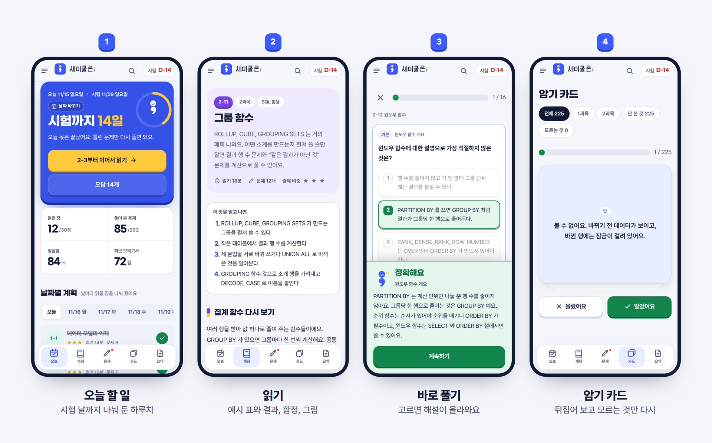

  

  <a href="https://insane-p.github.io/semicolon-sqld/"><b>바로 열기 →</b></a>

SQL 문장 끝에 붙는 세미콜론(;)에서 따온 이름이에요.

시험 범위 전체를 30개 장으로 나눠 읽고, 장 끝에서 바로 문제를 풀고, 틀린 문제만 다시 보도록 만들었어요. 가입이나 설치 없이 주소만 열면 돼요.

  

## 들어 있는 것

| | |
| --- | --- |
| **개념 30장** | 1과목 10장, 2과목 20장. 장마다 작은 예시 표와 SQL 실행 결과, 시험이 속이는 지점, 그림이 들어 있어요. |
| **문제 262개** | 결과를 계산하는 문제가 절반 가까이 돼요. 실제 시험처럼 "적절하지 않은 것", "결과가 다른 것" 형식으로 나와요. |
| **모의고사** | 50문항 90분. 실제 출제 비중대로 뽑고, 과목별 과락까지 채점해요. |
| **오답 노트** | 틀린 문제가 알아서 모여요. 다시 맞히면 빠지고, 또 틀리면 남아요. |
| **암기 카드 225장** | 뒤집어서 답을 보고, 몰랐던 카드만 다시 돌려요. |
| **한 장 요약** | 장마다 시험 직전에 볼 줄만 모았어요. 인쇄할 수 있어요. |

## 이렇게 쓰면 돼요

1. **오늘 할 일**부터 열어요. 시험 날까지 장을 날짜별로 나눠 두었고, 못 끝낸 장은 다음 날 맨 위로 올라와요.
2. 장을 다 읽으면 끝에 붙은 문제를 바로 풀어요. 고르는 순간 해설이 나와요.
3. 시간이 모자라면 별 세 개(★★★)인 장부터 읽어요. 거의 매회 나오는 장이에요.
4. 시험 전날에는 모의고사를 한 번 보고, 틀린 문제를 다시 풀고, 한 장 요약을 훑어요.

합격선은 60점이고, 1과목 10문항 중 4개, 2과목 40문항 중 16개보다 적게 맞히면 총점과 상관없이 떨어져요. 1과목을 버리면 안 되는 이유예요.

## 알아 두면 좋은 것

- **기록은 지금 쓰는 브라우저에만 남아요.** 휴대폰과 노트북을 오가면 기록이 따로 쌓여요. 한쪽을 정해 두고 쓰는 게 좋아요.
- **휴대폰에 앱처럼 깔 수 있어요.** 안드로이드 크롬은 첫 화면의 "설치하기", 아이폰 사파리는 공유 버튼의 "홈 화면에 추가"를 누르면 돼요. 한 번 열어 두면 인터넷이 끊긴 곳에서도 열려요.
- **찾기**: 위쪽 돋보기를 누르거나 키보드로 <kbd>/</kbd> 를 누르면 장 제목, 소제목, 요약, 암기 카드에서 낱말을 찾아요. 누르면 그 자리로 바로 가요.
- **어두운 화면**은 왼쪽 위 달 모양 버튼으로 바꿀 수 있어요.
- 키보드로도 풀 수 있어요. 문제에서 <kbd>1</kbd>~<kbd>4</kbd> 로 고르고 <kbd>Enter</kbd> 로 넘어가요. 암기 카드는 <kbd>Space</kbd> 로 뒤집어요.
- 시험 날짜는 첫 화면의 "날짜 바꾸기"에서 골라요. 다가오는 회차가 단추로 나와 있어서 누르기만 하면 돼요. 2027년 날짜는 공고 전이라 "예상"으로 표시돼 있으니 접수 전에 [데이터자격검정](https://www.dataq.or.kr) 에서 확인해 주세요.
- 장 화면 위쪽 "가 가 가" 로 글자 크기를 바꿀 수 있어요. 다시 들어오면 지난번에 읽던 소제목으로 이어 갈 수 있어요.
- 암기 카드는 장 하나만 골라 볼 수 있어요. 장 끝 "이 장 암기 카드" 링크로 바로 가도 돼요. 휴대폰에서는 뒤집은 다음 옆으로 밀어서 넘겨요.

## 내용에 대해

설명과 문제는 SQLD 출제 범위를 기준으로 새로 썼어요. 모든 문제는 다른 사람이 답을 가리고 처음부터 다시 풀어 정답을 맞춰 봤어요. SQL 은 Oracle 기준이고, SQL Server 와 다르게 동작하는 곳은 본문에서 따로 짚었어요.

틀린 설명이나 답이 이상한 문제를 찾으면 [이슈](https://github.com/INSANE-P/semicolon-sqld/issues)로 알려 주세요.

고쳐서 쓰고 싶다면

빌드가 없어요. 저장소를 받아 `index.html` 을 브라우저로 열면 돼요.

- 장 하나가 `content/` 아래 파일 하나예요. 규격은 [docs/CONTENT-SPEC.md](docs/CONTENT-SPEC.md), 본보기는 `content/m9.js` 예요.
- 고친 뒤에는 `node tools/validate.mjs` 로 형식을 검사해요.
- 화면과 브랜드를 왜 이렇게 정했는지는 [docs/DESIGN.md](docs/DESIGN.md) 에 있어요.

   
  세미콜론, SQLD 합격 노트

